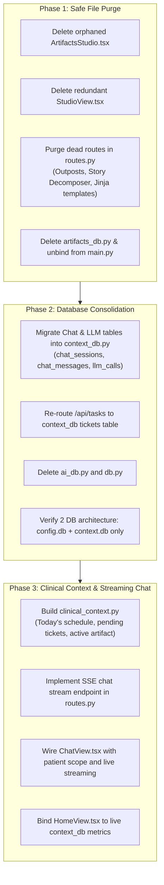

# Agent-D — Codebase Redundancy Audit & Milestone 3 Cleanup Plan

> **Audit Date:** 2026-10-21  
> **Target Execution:** Milestone 3 (Conversational Command Center & Chat Migration)

This document provides a line-by-line inspection of redundant, orphaned, dead, and partially refactored code across the Agent-D codebase resulting from the fork from `pm_tool`, accompanied by a phased cleanup process for Milestone 3.

---

## 1. Inventory of Identified Redundancies & Dead Code

### Category A: Backend Legacy Database Managers & Storage (pm_tool residue)

| File | Size | Current Usage | Issues & Redundancy | Recommended Action |
|---|---|---|---|---|
| `artifacts_db.py` | 260 lines | Imported in `main.py`, used by `/api/artifacts` in `routes.py` | Fully superseded by `context_db.py`'s structured JSON `artifacts` and `artifact_versions` tables. Creates an unnecessary third database file (`artifacts.db`). | **Delete in M3**. Remove imports from `main.py` and `routes.py`. |
| `ai_db.py` | 441 lines | Imported in `main.py`, used by `/api/conversations` in `routes.py` | Manages legacy `ai_context.db` for un-scoped chat messages. The target architecture defines `chat_sessions`, `chat_messages`, and `llm_calls` inside encrypted `context.db`. | **Migrate & Delete in M3**. Wire chat endpoints to `context_db.py`, then delete `ai_db.py`. |
| `db.py` | 1,180 lines | Imported in `main.py`, `routes.py`, `system_context.py` | Manages legacy `pmtool.db` (projects, sprints, story points, outposts). Creates an unnecessary database file. | **Phase out in M3**. Re-route `/api/tasks` to `context_db.py` (`tickets` table) and remove project CRUD. |
| `system_context.py` | 283 lines | Imported in `routes.py` line 11 | Builds PM Tool prompt context by querying software projects and sprint backlogs from `db.py`. | **Replace in M3** with `clinical_context.py` that queries today's schedule, pending tickets, and active patient artifacts from `context_db.py`. |
| `notifier.py` | 47 lines | Imported in `routes.py` | Desktop notification helper for Windows. Largely redundant with Electron's IPC notifier (`window.electronNotifier`). | **Consolidate** or retain strictly as headless fallback. |

---

### Category B: Dead & Unwired Endpoints in `routes.py`

| Route Range | Endpoints | Root Cause | Failure Mode | Recommended Action |
|---|---|---|---|---|
| Lines 43–96 | `@bp.route("/legacy")`, `/home`, `/board`, `/chat`, `/documents`, `/dashboard`, `/settings` | Legacy multi-frame HTML rendering routes from PM Tool. | Returns `render_template()` for Jinja2 templates purged in M0; throws 500 error if requested. | **Delete in M3**. Keep only `/` (serves SPA `index.html`) and `/assets/<filename>`. |
| Lines 428–475 | `@bp.route("/api/tools/breakdown")`, `/api/tools/breakdown/commit` | Agile user story decomposition from PRDs. | Imports `tools.story_decomposer` which was purged in M0; throws `ModuleNotFoundError`. | **Delete in M3**. |
| Lines 2170–2286 | `@bp.route("/api/outposts/jira/*")`, `/notion/*`, `/gdocs/*` | Outpost sync to Jira, Notion, and Google Docs. | Imports `ports.` and `adapters.` which were purged in M0; throws `ModuleNotFoundError`. | **Delete in M3**. |
| Lines 1798–1870 | `@bp.route("/api/analytics/funnel")`, `/api/analytics/cohorts` | Data Studio analytical engines. | PM Tool KPI analytics; out of clinical scope. | **Delete in M3**. |

---

### Category C: Orphaned & Redundant Frontend Code (`electron/src/`)

| File / Component | Size | Current Usage | Issues & Redundancy | Recommended Action |
|---|---|---|---|---|
| `components/docs/ArtifactsStudio.tsx` | 482 lines | **0 imports** across entire frontend | Orphaned markdown living document editor from PM Tool. Superseded by `views/DocsView.tsx`. | **Delete in M3**. |
| `views/StudioView.tsx` | 57 lines | Imported in `App.tsx` (`activeTab === 'dashboard'`) | Stub for old Data Studio SQL editor. Not present in `Sidebar.tsx` navigation. | **Delete in M3**. Remove tab from `App.tsx` and `types/index.ts`. |
| `components/onboarding/OnboardingModal.tsx` | 785 lines | Rendered in `App.tsx` (deferred) | Hardcoded software development wizard ("Developer Tools", "FinTech", sprint backlogs, Ollama vs API). | **Replace or Remove in M3**. Replace with lightweight clinical setup (Gemini key vault + Doctor name). |
| `components/patients/PatientModal.tsx` | 235 lines | Rendered in `App.tsx` | Simple modal popup created early in M1. Fully superseded by `views/PatientsView.tsx`. | **Consolidate/Remove in M3**. All patient operations now happen in `PatientsView.tsx`. |

---

### Category D: Unwired Real-Time Views

| View / File | Current State | Required Refactoring |
|---|---|---|
| `views/ChatView.tsx` | Calls `AppBridge.api.getConversations()` which talks to `ai_db.py` (`ai_context.db`). Uses PM Tool chat prompt. | Needs rewiring to patient-scoped sessions (`/api/v1/patients/<id>/chat`), SSE streaming, and live clinical context. |
| `views/HomeView.tsx` | Contains hardcoded static preview cards ("Today's Visits: 4", "Pre-Visit Brief: Patient PT-7821"). | Needs dynamic binding to `context_db.py` (`appointments`, `tickets`, active patient brief). |

---

## 2. Milestone 3 Cleanup & Modernization Execution Plan

The cleanup process will be executed systematically as **Phase 1 of Milestone 3**:

### Detailed Execution Steps:

#### Step 1: Frontend Dead Code Removal
1. Delete `electron/src/components/docs/ArtifactsStudio.tsx`.
2. Delete `electron/src/views/StudioView.tsx`.
3. In `electron/src/App.tsx`, remove `StudioView` import and `{activeTab === 'dashboard' && ...}` branch.
4. In `electron/src/types/index.ts`, remove `'dashboard'` from `NavTab`.
5. Run `cd electron; npm run build:ui` to confirm zero broken imports.

#### Step 2: Backend Route Pruning (`routes.py`)
1. Remove all dead SaaS outpost routes (`/api/outposts/jira/*`, `/notion/*`, `/gdocs/*`).
2. Remove all story breakdown routes (`/api/tools/breakdown`, `/api/tools/breakdown/commit`).
3. Remove legacy analytical routes (`/api/analytics/funnel`, `/api/analytics/cohorts`).
4. Remove dead Jinja template page routes (`/legacy`, `/home`, `/board`, `/chat`, `/documents`, `/dashboard`, `/settings`), retaining only the SPA root (`/`) and asset loader (`/assets/<filename>`).
5. Remove `artifacts_db.py` entirely and remove its initialization from `main.py`.

#### Step 3: Chat Pipeline & Database Consolidation
1. Implement patient-scoped chat session CRUD in `context_db.py` (`chat_sessions`, `chat_messages`, `llm_calls`).
2. Wire `ChatView.tsx` and `routes.py` to use `context_db.py` for conversations.
3. Once chat is decoupled from `ai_db.py`, delete `ai_db.py` and remove from `main.py`.
4. Replace `system_context.py` with `clinical_context.py` for live practice context injection.
5. Re-route Kanban tickets to `context_db.py`'s `tickets` table and decommission `db.py`.

---

## 3. Verification Safeguards
After executing the cleanup process:
- Execute `python test_m1.py` and `python test_m2.py` to ensure zero regression in core databases.
- Execute `npm run build:ui` to ensure 0 TypeScript / bundler errors.
- Confirm only 2 database files exist in `%LOCALAPPDATA%\AgentD\`: `config.db` and `context.db`.
