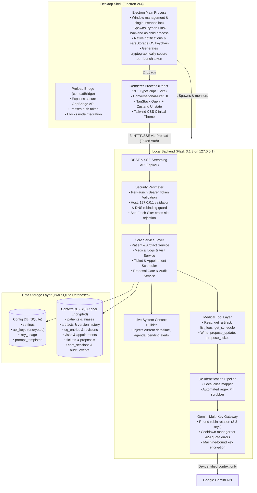

# Doctor's Copilot: Engineering & UI Architecture Specification v1.0

**Status:** Approved Architecture Draft  
**Target Date:** October 2026  
**System Type:** Local-First Desktop Medical Assistant (Conversational-First Clinical Workspace)

---

## 1. Executive Summary & Design Philosophy

Doctor’s Copilot is a local-first desktop application designed for an individual physician. Unlike legacy Electronic Health Record (EHR) systems that force clinicians into endless form-filling and static tab navigation, Doctor’s Copilot positions the **AI Copilot as the Primary Operating Interface**. 

The doctor converses naturally with their practice data—asking for daily agenda briefs, requesting pre-visit summaries, or dictating consultation outcomes—while the system maintains strict deterministic safeguards:
1. **Doctor in Absolute Control:** The AI never modifies clinical records directly. Every AI mutation produces a typed **Proposal** with a side-by-side visual diff that the doctor must explicitly approve, modify, or reject.
2. **Conversational-First Command Center:** 60% of the viewport is dedicated to the intelligent Copilot stream with embedded interactive Generative UI cards (Schedule Card, Patient Brief Card, Proposal Diff Card). A 40% companion drawer maintains synchronized, live inspection of the official patient chart.
3. **90% White Clinical Aesthetic:** High-clarity medical design: 90% clean white canvas (`#FFFFFF`), hospital-grade blue primary interactive buttons (`#2563EB`), and delicate white-grey borders (`#E2E8F0`).
4. **Local-First & Cryptographically Partitioned:** Operates completely on the local machine with two isolated SQLite databases. Clinical data is encrypted at rest using SQLCipher. External LLM calls transmit only de-identified, curated context with automated regex PII scrubbing.

---

## 2. System Architecture



### 2.1 Process Lifecycle & IPC
* **Startup Sequence:**
  1. Electron initializes `app.whenReady()`.
  2. Electron generates a 32-byte cryptographically random hex token: `LAUNCH_AUTH_TOKEN`.
  3. Electron locates an available port between 5050 and 5065 and spawns the Flask process (`python main.py` in development, or bundled `flask.exe` in production) passing `--token=<LAUNCH_AUTH_TOKEN>` and `--port=<PORT>`.
  4. Flask validates port availability, initializes the database connection pools, outputs `[DC_HANDSHAKE] PORT=<PORT>` to `stdout`, and begins listening strictly on `127.0.0.1`.
  5. Electron captures the handshake signal via stdout, verifies health via `GET http://127.0.0.1:<PORT>/api/ping`, and creates the `BrowserWindow`.
  6. The preload script exposes `window.electronBridge` providing the auth token and backend URL to the React app.
* **Shutdown Sequence:**
  * On window close or `before-quit`, Electron dispatches a `SIGTERM` (or `taskkill /F /T /PID` on Windows) to terminate the Flask child process and its process tree cleanly, closing SQLite locks.
* **Single Instance Guarantee:**
  * Enforced using `app.requestSingleInstanceLock()`. Secondary instances immediately focus the existing window and terminate.

---

## 3. UI/UX Design System & Layout Architecture

### 3.1 The 90% White Clinical Design System

The visual language communicates clinical precision, calm authority, and zero distraction:

```
┌────────────────────────────────────────────────────────────────────────┐
│  Token                 Hex / Value        Application                  │
├────────────────────────────────────────────────────────────────────────┤
│  --bg-canvas           #FFFFFF            Main background (90% area)   │
│  --bg-subtle           #F8FAFC            Secondary card background    │
│  --bg-hover            #F1F5F9            Interactive hover state      │
│  --border-default      #E2E8F0            Card, divider, panel borders │
│  --border-subtle       #F1F5F9            Inner soft dividers          │
│  --border-focus        #3B82F6            Active input / ring border   │
│  --text-primary        #0F172A            High-contrast clinical text  │
│  --text-secondary      #475569            Labels, metadata, timestamps │
│  --text-muted          #94A3B8            Placeholders, disabled state │
│  --blue-primary        #2563EB            Primary CTA buttons, active  │
│  --blue-hover          #1D4ED8            Primary button hover state   │
│  --blue-subtle         #EFF6FF            Blue pill/tag background     │
│  --blue-text           #1D4ED8            Blue pill/tag text color     │
│  --status-normal       #059669            Approved, stable, cleared    │
│  --status-warning      #D97706            Watch-for, pending, review   │
│  --status-danger       #DC2626            Allergy, critical alert, diff│
└────────────────────────────────────────────────────────────────────────┘
```

### 3.2 Viewport Layout: Conversational-First Workspace

The desktop application operates on a modern split-pane architecture:

```
┌──────────────────────────────────────────────────────────────────────────────────────────────────┐
│ [🩺 Doctor's Copilot]      Patient: [ Dr. Sharma | Today: Oct 21, 2026 ]        [⚙ Settings] [— □ ✕]│ Top Bar (H: 48px, #FFFFFF, border-b)
├────┬───────────────────────────────────────────────┬──────────────────────────────────────────────┤
│ 📋 │ 💬 Conversational Command Center (60%)        │ 📂 Synchronized Context Inspector (40%)     │
│    │                                               │                                              │
│ 👤 │ Doctor: "What's on my dashboard today?"       │ [Context Artifact] [Logs] [Visits] [Tickets] │ Tabs
│    │                                               │ ──────────────────────────────────────────   │
│ 🩺 │ Copilot:                                      │ Patient: John Doe (Alias: PT-7821)           │
│    │ "Good morning, Doctor. You have 4 visits      │ Age: 58 | Sex: M | Blood: O+                 │
│ 📅 │ scheduled today. 1 pending proposal."         │                                              │
│    │ ┌───────────────────────────────────────────┐ │ ⚠️ Active Issues:                            │
│ 🎫 │ │ 📅 Today's Agenda (Oct 21)                │ │ • Type 2 Diabetes Mellitus                   │
│    │ │ • 09:30 AM — PT-7821 (Diabetes check)    │ │ • Essential Hypertension                   │
│ ⚙ │ │ • 10:15 AM — PT-4019 (Post-op dressing)   │ │                                              │
│    │ │ [Prepare for Next Patient] [View Queue]   │ │ 💊 Current Medications:                      │
│    │ └───────────────────────────────────────────┘ │ • Metformin 1000mg BID                       │
│    │                                               │ • Lisinopril 10mg QD                         │
│    │ Doctor: "Brief me on PT-7821."                │                                              │
│    │ Copilot:                                      │ 🔍 Watch-For Items:                          │
│    │ "PT-7821 last seen 3 weeks ago.              │ • Fasting blood glucose log                  │
│    │ Watch for: Tolerability of 1000mg Metformin   │ • Check serum creatinine & eGFR              │
│    │ and fasting glucose log."                     │                                              │
│    │                                               │ ──────────────────────────────────────────   │
│    │ ┌───────────────────────────────────────────┐ │ [✎ Edit Artifact]  [+ Add Observation]       │
│    │ │ ⚡ Proposed Artifact Update                │ │                                              │
│    │ │ - Metformin 500mg BID                     │ │ Version History: v4 (Approved Oct 14)       │
│    │ │ + Metformin 1000mg BID                    │ │                                              │
│    │ │ [ ✓ Approve Update ]  [ ✎ Edit ]  [ ✕ ]   │ │                                              │
│    │ └───────────────────────────────────────────┘ │                                              │
│    ├───────────────────────────────────────────────┤                                              │
│    │ [💬 Ask anything... e.g. 'Record BP 128/84'] [➤]│                                              │
│    │ Quick Chips: [☀️ Morning Brief] [🩺 Next] [📋 Approvals]                                     │
└────┴───────────────────────────────────────────────┴──────────────────────────────────────────────┘
```

#### Left Rail (Slim Nav, Width: 56px)
* Clean vertical icon bar:
  1. **Copilot Command Center** (Default Home)
  2. **Patients Directory**
  3. **Medical Logs Viewer**
  4. **Appointments & Schedule**
  5. **Tickets & Follow-ups**
  6. **Settings & Keys**

#### Center Pane: Copilot Stream (60% Width)
* Infinite-scroll conversational stream with auto-scroll and manual interrupt.
* **Generative UI Cards** rendered directly inside conversation turns:
  * **Agenda Card:** Interactive appointment timeline with one-click patient context switching.
  * **Pre-Visit Brief Card:** Synthesized summary with highlighted watch-for badges.
  * **Proposal Diff Card:** Color-coded diff (red/green lines) with one-click `[Approve]`, `[Edit]`, `[Reject]` actions.
  * **Ticket Card:** One-click task acceptance with due dates and priority badges.
* **Bottom Command Dock:**
  * Auto-expanding input textarea supporting multi-line dictation.
  * Quick patient mention tagger: typing `@` autocompletes patient aliases.
  * Quick action pills: `[☀️ Morning Brief]`, `[🩺 Next Patient]`, `[📋 Pending Proposals]`, `[⚡ Close Visit]`.

#### Right Pane: Live Context Inspector (40% Width)
* Automatically synchronizes with the active patient in conversation.
* Tabbed secondary views:
  * **Artifact Tab:** Displays the current official, doctor-approved JSON artifact rendered in a clean document structure.
  * **Logs Tab:** Chronological timeline of raw medical entries with type badges (Observation, Lab, Medication Change, Vitals).
  * **Visits Tab:** Historical consult records with collapsible notes.
  * **Tickets Tab:** Active action items and reminders associated with this patient.
* Header action button: `[Maximize / Collapse]` allowing the doctor to expand the chart to full-width when manual record entry is preferred.

---

## 4. Complete Database Architecture

The application uses **two completely separate SQLite database files** stored in `%LOCALAPPDATA%\DoctorsCopilot\`.

```
%LOCALAPPDATA%\DoctorsCopilot\
├── config.db          (Unencrypted or standard SQLite with machine-bound encrypted secrets)
└── context.db         (SQLCipher AES-256 encrypted clinical database)
```

### 4.1 Config DB (`config.db`) Schema DDL

```sql
-- 1. App Configuration & Preferences
CREATE TABLE IF NOT EXISTS app_settings (
    key TEXT PRIMARY KEY,
    value TEXT NOT NULL,
    updated_at TIMESTAMP DEFAULT CURRENT_TIMESTAMP
);

-- 2. Multi-Key Gemini API Key Management
CREATE TABLE IF NOT EXISTS api_keys (
    id TEXT PRIMARY KEY,               -- UUID
    provider TEXT NOT NULL DEFAULT 'gemini',
    key_label TEXT NOT NULL,           -- e.g. "Primary Key - Workspace A"
    encrypted_key TEXT NOT NULL,       -- PBKDF2-HMAC-SHA256 encrypted key
    masked_key TEXT NOT NULL,          -- e.g. "AIzaSy...4xQ1"
    is_active INTEGER NOT NULL DEFAULT 1,
    priority INTEGER NOT NULL DEFAULT 1,
    created_at TIMESTAMP DEFAULT CURRENT_TIMESTAMP
);

-- 3. Per-Key Usage and Cooldown Tracking
CREATE TABLE IF NOT EXISTS key_usage (
    key_id TEXT PRIMARY KEY,
    total_calls INTEGER NOT NULL DEFAULT 0,
    successful_calls INTEGER NOT NULL DEFAULT 0,
    rate_limit_errors INTEGER NOT NULL DEFAULT 0,
    last_used_at TIMESTAMP,
    cooldown_until TIMESTAMP,         -- If set, key is skipped during rotation until timestamp
    last_error_message TEXT,
    FOREIGN KEY (key_id) REFERENCES api_keys(id) ON DELETE CASCADE
);

-- 4. Versioned System Prompts
CREATE TABLE IF NOT EXISTS prompt_templates (
    id TEXT PRIMARY KEY,
    template_name TEXT NOT NULL UNIQUE, -- 'system_copilot', 'pre_visit_brief', 'visit_closer'
    prompt_content TEXT NOT NULL,
    version INTEGER NOT NULL DEFAULT 1,
    is_active INTEGER NOT NULL DEFAULT 1,
    updated_at TIMESTAMP DEFAULT CURRENT_TIMESTAMP
);

-- 5. Application Schema State
CREATE TABLE IF NOT EXISTS app_state (
    key TEXT PRIMARY KEY,
    value TEXT NOT NULL
);
```

### 4.2 Context DB (`context.db` - Encrypted with SQLCipher) Schema DDL

```sql
-- PRAGMA key = 'derived_passphrase_key';
-- PRAGMA cipher_page_size = 4096;
-- PRAGMA kdf_iter = 64000;
-- PRAGMA journal_mode = WAL;

-- 1. Patients Master
CREATE TABLE IF NOT EXISTS patients (
    id TEXT PRIMARY KEY,               -- Internal UUID
    display_name TEXT NOT NULL,        -- Real patient name (Doctor's eyes only)
    llm_alias TEXT NOT NULL UNIQUE,    -- e.g. "PT-7821" (sent to external LLM)
    date_of_birth TEXT,
    gender TEXT,
    blood_group TEXT,
    phone TEXT,
    email TEXT,
    status TEXT NOT NULL DEFAULT 'active', -- 'active' | 'archived'
    created_at TIMESTAMP DEFAULT CURRENT_TIMESTAMP,
    updated_at TIMESTAMP DEFAULT CURRENT_TIMESTAMP
);

-- 2. Current Structured Patient Artifact (1 per patient)
CREATE TABLE IF NOT EXISTS artifacts (
    patient_id TEXT PRIMARY KEY,
    summary TEXT NOT NULL DEFAULT '',
    active_issues JSON NOT NULL DEFAULT '[]',     -- Array of {id, condition, diagnosed_date, status}
    medications JSON NOT NULL DEFAULT '[]',       -- Array of {id, name, dosage, frequency, started_date}
    watch_for JSON NOT NULL DEFAULT '[]',         -- Array of string items
    follow_ups JSON NOT NULL DEFAULT '[]',        -- Array of {id, item, due_date}
    notes TEXT NOT NULL DEFAULT '',
    needs_review INTEGER NOT NULL DEFAULT 0,      -- Flagged when log entries change
    schema_version INTEGER NOT NULL DEFAULT 1,
    updated_at TIMESTAMP DEFAULT CURRENT_TIMESTAMP,
    FOREIGN KEY (patient_id) REFERENCES patients(id) ON DELETE CASCADE
);

-- 3. Immutable Artifact Version History
CREATE TABLE IF NOT EXISTS artifact_versions (
    id TEXT PRIMARY KEY,               -- UUID
    patient_id TEXT NOT NULL,
    version_num INTEGER NOT NULL,
    artifact_json JSON NOT NULL,       -- Snapshot of full artifact
    author_type TEXT NOT NULL,         -- 'doctor_manual' | 'proposal_approved'
    proposal_id TEXT,                  -- Optional link to approved proposal
    change_summary TEXT,
    created_at TIMESTAMP DEFAULT CURRENT_TIMESTAMP,
    FOREIGN KEY (patient_id) REFERENCES patients(id) ON DELETE CASCADE
);

-- 4. Medical Log Entries (Dated clinical observations)
CREATE TABLE IF NOT EXISTS log_entries (
    id TEXT PRIMARY KEY,
    patient_id TEXT NOT NULL,
    entry_date DATE NOT NULL,
    entry_type TEXT NOT NULL,          -- 'observation' | 'vitals' | 'medication_change' | 'lab_note' | 'symptom'
    content TEXT NOT NULL,
    metadata JSON DEFAULT '{}',        -- e.g. {"bp": "120/80", "hr": 72, "temp": 98.6}
    source TEXT NOT NULL DEFAULT 'manual', -- 'manual' | 'visit_close' | 'proposal_approved'
    visit_id TEXT,
    created_at TIMESTAMP DEFAULT CURRENT_TIMESTAMP,
    updated_at TIMESTAMP DEFAULT CURRENT_TIMESTAMP,
    FOREIGN KEY (patient_id) REFERENCES patients(id) ON DELETE CASCADE,
    FOREIGN KEY (visit_id) REFERENCES visits(id) ON DELETE SET NULL
);

-- 5. Medical Log Revisions
CREATE TABLE IF NOT EXISTS log_entry_versions (
    id TEXT PRIMARY KEY,
    entry_id TEXT NOT NULL,
    previous_content TEXT NOT NULL,
    edited_at TIMESTAMP DEFAULT CURRENT_TIMESTAMP,
    edit_reason TEXT,
    FOREIGN KEY (entry_id) REFERENCES log_entries(id) ON DELETE CASCADE
);

-- 6. Consultations & Visits
CREATE TABLE IF NOT EXISTS visits (
    id TEXT PRIMARY KEY,
    patient_id TEXT NOT NULL,
    visit_date TIMESTAMP NOT NULL DEFAULT CURRENT_TIMESTAMP,
    reason TEXT NOT NULL,
    doctor_notes TEXT,
    status TEXT NOT NULL DEFAULT 'open', -- 'open' | 'closed'
    closed_at TIMESTAMP,
    outcome_summary TEXT,
    created_at TIMESTAMP DEFAULT CURRENT_TIMESTAMP,
    FOREIGN KEY (patient_id) REFERENCES patients(id) ON DELETE CASCADE
);

-- 7. Appointments (Schedule)
CREATE TABLE IF NOT EXISTS appointments (
    id TEXT PRIMARY KEY,
    patient_id TEXT NOT NULL,
    scheduled_time TIMESTAMP NOT NULL,
    duration_minutes INTEGER NOT NULL DEFAULT 15,
    appointment_type TEXT NOT NULL DEFAULT 'follow_up', -- 'new_patient' | 'follow_up' | 'urgent'
    reason TEXT,
    status TEXT NOT NULL DEFAULT 'scheduled', -- 'scheduled' | 'completed' | 'cancelled' | 'no_show'
    created_at TIMESTAMP DEFAULT CURRENT_TIMESTAMP,
    FOREIGN KEY (patient_id) REFERENCES patients(id) ON DELETE CASCADE
);

-- 8. Tickets & Action Items
CREATE TABLE IF NOT EXISTS tickets (
    id TEXT PRIMARY KEY,
    patient_id TEXT,                   -- Optional patient link
    visit_id TEXT,                     -- Optional visit link
    title TEXT NOT NULL,
    description TEXT,
    priority TEXT NOT NULL DEFAULT 'medium', -- 'critical' | 'high' | 'medium' | 'low'
    status TEXT NOT NULL DEFAULT 'open',     -- 'open' | 'in_progress' | 'done'
    due_date DATE,
    due_time TIME,
    is_reminder INTEGER NOT NULL DEFAULT 0,
    created_at TIMESTAMP DEFAULT CURRENT_TIMESTAMP,
    updated_at TIMESTAMP DEFAULT CURRENT_TIMESTAMP,
    FOREIGN KEY (patient_id) REFERENCES patients(id) ON DELETE SET NULL,
    FOREIGN KEY (visit_id) REFERENCES visits(id) ON DELETE SET NULL
);

-- 9. Assistant Proposals (The Safety Gate)
CREATE TABLE IF NOT EXISTS proposals (
    id TEXT PRIMARY KEY,
    patient_id TEXT NOT NULL,
    visit_id TEXT,
    proposal_type TEXT NOT NULL,       -- 'artifact_edit' | 'log_entry' | 'ticket' | 'reminder'
    payload JSON NOT NULL,             -- The proposed object
    diff JSON,                         -- Structured diff: {field, old_value, new_value}
    rationale TEXT NOT NULL,           -- Assistant explanation
    status TEXT NOT NULL DEFAULT 'pending', -- 'pending' | 'accepted' | 'edited_accepted' | 'rejected' | 'expired'
    created_at TIMESTAMP DEFAULT CURRENT_TIMESTAMP,
    resolved_at TIMESTAMP,
    expires_at TIMESTAMP,
    FOREIGN KEY (patient_id) REFERENCES patients(id) ON DELETE CASCADE
);

-- 10. Chat Sessions & Messages
CREATE TABLE IF NOT EXISTS chat_sessions (
    id TEXT PRIMARY KEY,
    patient_id TEXT,                   -- NULL for global workspace chat, or UUID for patient-scoped
    title TEXT NOT NULL DEFAULT 'Consultation Chat',
    created_at TIMESTAMP DEFAULT CURRENT_TIMESTAMP,
    updated_at TIMESTAMP DEFAULT CURRENT_TIMESTAMP,
    FOREIGN KEY (patient_id) REFERENCES patients(id) ON DELETE CASCADE
);

CREATE TABLE IF NOT EXISTS chat_messages (
    id TEXT PRIMARY KEY,
    session_id TEXT NOT NULL,
    role TEXT NOT NULL,                -- 'user' | 'assistant' | 'system'
    content TEXT NOT NULL,
    model_name TEXT,
    tokens_used INTEGER DEFAULT 0,
    tool_calls JSON DEFAULT '[]',      -- Structured array of tools invoked
    created_at TIMESTAMP DEFAULT CURRENT_TIMESTAMP,
    FOREIGN KEY (session_id) REFERENCES chat_sessions(id) ON DELETE CASCADE
);

-- 11. Pre-Visit Briefs Archive
CREATE TABLE IF NOT EXISTS briefs (
    id TEXT PRIMARY KEY,
    patient_id TEXT NOT NULL,
    appointment_id TEXT NOT NULL,
    brief_content TEXT NOT NULL,
    watch_for_highlights JSON NOT NULL DEFAULT '[]',
    generated_at TIMESTAMP DEFAULT CURRENT_TIMESTAMP,
    FOREIGN KEY (patient_id) REFERENCES patients(id) ON DELETE CASCADE,
    FOREIGN KEY (appointment_id) REFERENCES appointments(id) ON DELETE CASCADE
);

-- 12. Complete LLM Audit Log
CREATE TABLE IF NOT EXISTS llm_calls (
    id TEXT PRIMARY KEY,
    session_id TEXT,
    call_purpose TEXT NOT NULL,        -- 'chat' | 'brief' | 'visit_close'
    model_name TEXT NOT NULL,
    key_id_used TEXT,
    prompt_payload TEXT NOT NULL,      -- Exact de-identified prompt sent
    raw_response TEXT NOT NULL,        -- Exact text returned
    latency_ms INTEGER NOT NULL,
    success INTEGER NOT NULL,
    created_at TIMESTAMP DEFAULT CURRENT_TIMESTAMP
);

-- 13. System Audit Events
CREATE TABLE IF NOT EXISTS audit_events (
    id TEXT PRIMARY KEY,
    entity_type TEXT NOT NULL,         -- 'patient' | 'artifact' | 'log' | 'proposal' | 'key'
    entity_id TEXT NOT NULL,
    action TEXT NOT NULL,              -- 'create' | 'update' | 'delete' | 'accept' | 'reject'
    actor TEXT NOT NULL DEFAULT 'doctor', -- 'doctor' | 'assistant_approved' | 'system'
    details JSON,
    timestamp TIMESTAMP DEFAULT CURRENT_TIMESTAMP
);
```

---

## 5. Intelligence Engine & Tool Layer

### 5.1 Real-Time System Context Builder
Prior to dispatching any prompt to the LLM Gateway, the backend executes `system_context.py` to construct an awareness envelope:
1. **Clock & Temporal Anchor:** Current ISO date, day of week, and local time.
2. **Current Patient Context:** If a patient is actively loaded or mentioned, pulls their alias, age, gender, active conditions, and current medications.
3. **Today's Practice State:**
   * Total scheduled appointments today, current appointment index, and next patient alias.
   * Total pending proposals awaiting doctor signature.
   * Total overdue tickets requiring clinical follow-up.

### 5.2 De-Identification & PII Sanitizer Pipeline
Under no circumstance is direct patient PII sent over the wire to external LLM APIs.
1. **Alias Substitution:** The patient's legal name, phone number, address, and government IDs are swapped for their assigned `llm_alias` (e.g., `PT-7821`). The lookup table exists exclusively in the encrypted `context.db`.
2. **Deterministic Regex PII Scrubber:**
   * **Phone numbers:** Matches 10-12 digit patterns, international formats `+XX`, and redacted to `[REDACTED_PHONE]`.
   * **Email addresses:** RFC 5322 regex matching, redacted to `[REDACTED_EMAIL]`.
   * **Government IDs / Aadhaar / SSN:** Redacted to `[REDACTED_ID]`.
   * **Dates of Birth:** Converts raw birthdates to age in years (e.g., "58-year-old").
3. **Audit Verification:** The exact scrubbed payload sent to the LLM is recorded in `llm_calls` and inspectable by the doctor at any time via Settings → LLM Inspector.

### 5.3 Medical Tool Layer
The LLM communicates through strict, typed function calling:

```
Read Tools (Direct Execution):
┌─────────────────────────┬────────────────────────────────────────────────────────┐
│ Tool                    │ Purpose                                                │
├─────────────────────────┼────────────────────────────────────────────────────────┤
│ get_today_agenda()      │ Retrieves today's appointment list and stats           │
│ get_next_patient()      │ Identifies next scheduled patient and brief status     │
│ get_patient_artifact()  │ Retrieves structured artifact for a given alias        │
│ get_patient_logs()      │ Fetches recent dated medical log entries               │
│ get_open_tickets()      │ Fetches pending tickets/reminders                      │
└─────────────────────────┴────────────────────────────────────────────────────────┘

Write Tools (PROPOSAL GENERATION ONLY — Never Writes to DB directly):
┌─────────────────────────┬────────────────────────────────────────────────────────┐
│ Tool                    │ Produced Proposal Object                               │
├─────────────────────────┼────────────────────────────────────────────────────────┤
│ propose_artifact_update │ Creates a pending proposal with field-level diff       │
│ propose_log_entry       │ Proposes a new dated clinical observation              │
│ propose_ticket          │ Proposes an actionable ticket with due date/priority   │
│ propose_reminder        │ Proposes a time-specific notification reminder         │
└─────────────────────────┴────────────────────────────────────────────────────────┘
```

### 5.4 Gemini Multi-Key Rotation Engine
Located in `llm/gateway.py`, upgrading `pm_tool`'s single-key dispatch:
* **Key Pool:** Stores 2 to 3 Gemini API keys with machine-bound encryption (PBKDF2 salt + AES/XOR cipher).
* **Round-Robin Selection:** Rotates through active, non-cooldown keys.
* **Intelligent Cooldown on Quota Limits:**
  * When a key encounters HTTP `429 (Resource Exhausted)`, it is tagged with a `cooldown_until = now() + 60 seconds`.
  * The request automatically and immediately fails over to the next available healthy key without failing the doctor's turn.
  * If all keys are exhausted, the app cleanly notifies the user with a retry countdown.

---

## 6. End-to-End Core Workflows

### 6.1 Workflow A: "What's on my dashboard today?" (Morning Brief)
1. Doctor types or clicks chip: *"What's on my dashboard today?"*
2. Frontend issues `POST /api/v1/chat` with message.
3. Backend checks `system_context.py` and detects an agenda request.
4. LLM calls read tool `get_today_agenda()`.
5. Backend returns scheduled appointments, overdue tickets, and pending proposal count.
6. Copilot streams synthesized executive response via Server-Sent Events (SSE).
7. Along with the text stream, Copilot returns a specialized UI event:
   ```json
   {
     "type": "widget:agenda",
     "data": {
       "total_patients": 4,
       "next_patient": {"id": "p-101", "alias": "PT-7821", "time": "09:30 AM", "reason": "Diabetes follow-up"},
       "pending_proposals": 1,
       "overdue_tickets": 2
     }
   }
   ```
8. The frontend chat component renders an interactive **Agenda Card** with `[Start Visit for PT-7821]` button.

### 6.2 Workflow B: Pre-Visit Briefing
1. 10 minutes prior to an appointment (or when requested by the doctor), the scheduler fires.
2. System compiles:
   * Current patient artifact (active issues, current medications, watch-for items).
   * Last visit notes and outcome.
   * Recent lab logs.
3. LLM executes prompt: *"Generate a 3-bullet pre-visit brief: 1) What changed last visit, 2) Key watch-for items today, 3) Open follow-ups."*
4. Output is stored in `briefs` table and pushed to the desktop as a native Electron notification and rendered on the Copilot stream.

### 6.3 Workflow C: Visit Documentation & Proposal Approval
1. Doctor starts visit for Patient `PT-7821`.
2. Doctor dictates or enters consult notes: *"Patient tolerated 1000mg Metformin well, no GI upset. BP today 126/82. Fasting glucose 108. Continue meds, recheck HbA1c in 3 months."*
3. Doctor clicks `[Close Visit]`.
4. Copilot executes `propose_artifact_update` and `propose_ticket`.
5. Backend writes two records to `proposals` with `status: 'pending'`.
6. Frontend chat renders two **Interactive Diff Cards**:
   * **Diff Card 1:** Artifact Update
     ```diff
     Medications:
       Metformin 500mg BID
     + Metformin 1000mg BID (tolerated well)
     Active Issues:
       Hypertension (BP baseline updated to 126/82)
     ```
     Buttons: `[ ✓ Approve ]` `[ ✎ Edit ]` `[ ✕ Reject ]`
   * **Diff Card 2:** Follow-up Ticket
     ```
     Ticket: Order 3-month HbA1c lab & follow-up visit
     Due: Jan 21, 2027 | Priority: Medium
     ```
     Buttons: `[ ✓ Approve ]` `[ ✕ Reject ]`
7. When the doctor clicks `[ ✓ Approve ]`:
   * Calls `POST /api/v1/proposals/:id/accept`.
   * Backend commits updates to `artifacts`, writes snapshot to `artifact_versions`, and records event in `audit_events`.
   * Context Inspector immediately animates the updated artifact in real time.

---

## 7. REST API Endpoint Specification

All endpoints require `Authorization: Bearer <LAUNCH_AUTH_TOKEN>` and run on `http://127.0.0.1:<PORT>/api/v1`.

| Area | Method & Endpoint | Payload / Params | Response Summary |
|---|---|---|---|
| **System** | `GET /ping` | None | `{ "status": "ok", "app": "DoctorsCopilot", "port": 5050 }` |
| **System** | `GET /system/context` | None | Live agenda snapshot, counts, clock |
| **Patients** | `GET /patients` | `?query=&status=active` | Array of patient summaries |
| **Patients** | `POST /patients` | `{ display_name, dob, gender, blood_group }` | Creates patient + auto-generates `llm_alias` |
| **Patients** | `GET /patients/:id` | None | Patient master + current artifact |
| **Artifacts** | `GET /patients/:id/artifact` | None | Current JSON artifact |
| **Artifacts** | `PATCH /patients/:id/artifact` | Partial artifact JSON | Manual doctor edit → creates version snapshot |
| **Artifacts** | `GET /patients/:id/artifact/versions` | None | Array of historical version snapshots |
| **Medical Logs** | `GET /patients/:id/logs` | `?type=&limit=50` | Chronological dated log entries |
| **Medical Logs** | `POST /patients/:id/logs` | `{ date, type, content, metadata }` | Creates log entry + flags artifact `needs_review` |
| **Visits** | `POST /visits` | `{ patient_id, reason }` | Creates open consultation record |
| **Visits** | `POST /visits/:id/close` | `{ doctor_notes }` | Closes visit + triggers LLM proposal generator |
| **Appointments** | `GET /appointments` | `?date=YYYY-MM-DD` | Day's schedule with patient alias links |
| **Appointments** | `POST /appointments` | `{ patient_id, time, reason }` | Schedules consultation |
| **Tickets** | `GET /tickets` | `?status=open&patient_id=` | Filtered action items |
| **Tickets** | `PATCH /tickets/:id` | `{ status, priority, due_date }` | Updates ticket |
| **Proposals** | `GET /proposals` | `?status=pending&patient_id=` | Queue of pending assistant proposals |
| **Proposals** | `POST /proposals/:id/accept` | None | Applies diff to live DB + creates audit record |
| **Proposals** | `POST /proposals/:id/reject` | `{ reason }` | Marks proposal rejected |
| **Chat** | `POST /chat` | `{ session_id, patient_id, message }` | SSE stream (`text/event-stream`) of tokens & tool cards |
| **Keys** | `GET /keys` | None | Masked keys list with usage and cooldown status |
| **Keys** | `POST /keys` | `{ label, api_key }` | Encrypts & stores new Gemini key |
| **Audit** | `GET /audit/llm-calls` | `?limit=50` | Inspector list of exact scrubbed payloads sent |

---

## 8. Frontend Implementation Blueprint

### 8.1 Tailwind Theme Configuration (`tailwind.config.js`)

```javascript
/** @type {import('tailwindcss').Config} */
export default {
  content: [
    "./index.html",
    "./src/**/*.{js,ts,jsx,tsx}",
  ],
  darkMode: 'class',
  theme: {
    extend: {
      colors: {
        canvas: {
          DEFAULT: '#FFFFFF',
          subtle: '#F8FAFC',
          hover: '#F1F5F9',
          active: '#E2E8F0',
        },
        border: {
          DEFAULT: '#E2E8F0',
          subtle: '#F1F5F9',
          strong: '#CBD5E1',
          focus: '#3B82F6',
        },
        blue: {
          DEFAULT: '#2563EB',   // Clinical Blue
          hover: '#1D4ED8',
          subtle: '#EFF6FF',
          border: '#BFDBFE',
          ring: 'rgba(37, 99, 235, 0.25)',
        },
        slate: {
          900: '#0F172A',       // Clinical high-contrast text
          700: '#334155',
          500: '#64748B',
          400: '#94A3B8',
          200: '#E2E8F0',
          100: '#F1F5F9',
        },
        status: {
          green: '#059669',     // Approved / Normal
          amber: '#D97706',     // Watch-for / Needs Review
          red: '#DC2626',       // Allergy / Rejected
          blue: '#2563EB',      // Active consultation
        }
      },
      fontFamily: {
        sans: ['Inter', '-apple-system', 'BlinkMacSystemFont', 'Segoe UI', 'Roboto', 'sans-serif'],
        mono: ['JetBrains Mono', 'Menlo', 'Monaco', 'Courier New', 'monospace'],
      },
      boxShadow: {
        card: '0 1px 3px 0 rgba(0, 0, 0, 0.05), 0 1px 2px -1px rgba(0, 0, 0, 0.05)',
        elevated: '0 4px 6px -1px rgba(0, 0, 0, 0.07), 0 2px 4px -2px rgba(0, 0, 0, 0.05)',
      }
    },
  },
  plugins: [],
}
```

### 8.2 Global CSS Tokens (`src/index.css`)

```css
@tailwind base;
@tailwind components;
@tailwind utilities;

*, *::before, *::after {
  box-sizing: border-box;
}

:root {
  --bg-canvas: #FFFFFF;
  --bg-card: #FFFFFF;
  --bg-subtle: #F8FAFC;
  --border-color: #E2E8F0;
  --text-main: #0F172A;
  --text-muted: #64748B;
  --blue-brand: #2563EB;
}

html, body, #root {
  height: 100%;
  width: 100%;
  margin: 0;
  padding: 0;
  background-color: var(--bg-canvas);
  color: var(--text-main);
  font-family: 'Inter', -apple-system, BlinkMacSystemFont, 'Segoe UI', Roboto, sans-serif;
  overflow: hidden;
  user-select: none;
}

/* Crisp Clean Scrollbars */
* {
  scrollbar-width: thin;
  scrollbar-color: #CBD5E1 transparent;
}

::-webkit-scrollbar {
  width: 6px;
  height: 6px;
}

::-webkit-scrollbar-track {
  background: transparent;
}

::-webkit-scrollbar-thumb {
  background: #CBD5E1;
  border-radius: 4px;
}

::-webkit-scrollbar-thumb:hover {
  background: #94A3B8;
}

/* Electron App Region Dragging */
.app-drag-region {
  -webkit-app-region: drag;
}

.app-no-drag {
  -webkit-app-region: no-drag;
}
```

---

## 9. Security, Privacy & Integrity Guarantees

1. **Zero External Raw Transmission:** Only doctor-curated context scrubbed of direct PII is transmitted to the Gemini API.
2. **Encrypted Context Database:** SQLite database with SQLCipher 256-bit AES encryption.
3. **No Autonomous Mutations:** The LLM cannot insert, update, or delete clinical records, prescriptions, or dosages. It emits proposals that require affirmative physician interaction (`status = 'accepted'`).
4. **Comprehensive Tamper-Evident Audit:** Every model inference, prompt payload, latency, and response token count is immutably logged into `llm_calls`. Every accepted proposal and manual revision generates an entry in `audit_events`.
5. **Network Isolation:** Flask binds exclusively to `127.0.0.1`. All calls are authenticated via the random per-launch token passed over Electron IPC preload.

---

## 10. Implementation Roadmap (Milestone Breakdown)

| Milestone | Deliverables | Verification Criteria |
|---|---|---|
| **M0: Fork & Strip** | Copy `pm_tool` into `Agent-D`, purge Data Studio/RAG/Outposts, rebrand to Doctor's Copilot, apply 90% white Tailwind theme. | Clean app launches with white/blue shell and passes handshake. |
| **M1: Core Databases & Security** | Create `config.db` and SQLCipher `context.db`, implement per-launch token auth, patient CRUD with auto-alias generation. | Patients can be created, stored securely, and queried via API. |
| **M2: Context Artifacts & Logs** | Structured JSON artifact editor, immutable version history table, dated log entries, visual diff generator. | Edits to artifacts create version snapshots; diffs render accurately. |
| **M3: Conversational Command Center** | 60/40 Split View UI, Copilot chat stream with SSE, live system context injection (`system_context.py`). | User can ask *"What's on my dashboard today?"* and receive dynamic brief. |
| **M4: Safety Gate & Proposal Queue** | LLM Write Tool Layer (`propose_*`), interactive Diff Cards in chat stream, approval/rejection endpoints. | Copilot proposes artifact update; clicking Approve updates DB and audits. |
| **M5: Visit Lifecycle & Multi-Key Gateway** | Consultation notes flow, "Close Visit" auto-proposal generator, Gemini multi-key rotation with cooldown. | Complete end-to-end consult flow: notes → proposals → approval → archive. |
| **M6: Packaging & Hardening** | PyInstaller backend bundling, electron-builder NSIS packaging, backup/restore verification on a clean PC. | Self-contained executable runs smoothly on clean Windows machine. |
